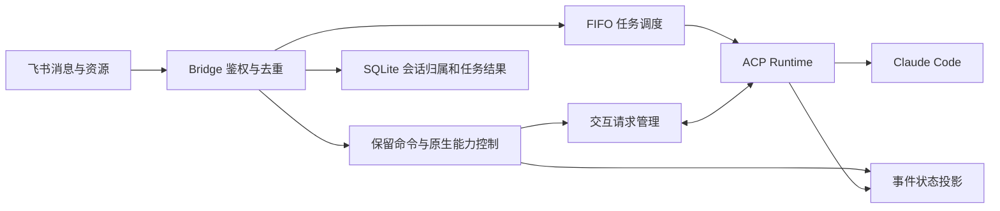

# Claude 原生能力接入

Bridge 使用现有 Claude ACP Adapter，不额外部署意图分类 LLM。能力以当前进程协商结果为准；协议与 Adapter 版本升级后需重新运行 stdio fixture 和真实会话验收。

## 架构边界



- `bridge.ts`：任务接纳、队列、互斥、执行截止时间、结果投递和闲置回收。独占范围包括附件准备、模型执行、必要的进程清理和终态落库。最终投递可与下一项任务执行重叠。
- `commands.ts`：统一识别保留命令，未知 slash 指令仍作为普通任务处理。
- `agent-features.ts`：原生能力命令的应用层，连接会话偏好、事件快照、问题与任务引导，不创建第二套任务队列。
- `agent-state.ts`：只保存有界的命令、工具标题/状态、计划、用量和配置快照；不保存工具原始参数、结果或思考文本。最近状态最多保留 128 个会话，重启后重新协商。
- `interactions.ts`：问题编号、字段校验、回答一次性消费与取消；不把回答作为新的 prompt。
- `runtime.ts`：ACP v1 协商、请求、事件、原生配置及进程生命周期。扩展接口仅在能力可用时调用。
- `runtime-config.ts`：读取部署者指定的 MCP 和执行限制，不接受任意 SDK 参数透传。
- `store.ts`：会话映射、历史归属、偏好、消息去重和任务结果。历史列表从 Bridge 记录查询，不扫描共享 Claude 目录。

## 已接入的交互

完整命令列表与用户可见行为以[使用与运维指南的命令表](usage.md#命令)为准，本节只说明原生能力侧的语义和边界。

管理查询、回答、跳过和引导不占队列容量。意外工具权限请求仍拒绝，不与普通问题混为一谈；计划模式的入口和执行方式见[命令表](usage.md#命令)。

问题的回答格式见[命令表](usage.md#命令)。Bridge 校验支持字符串、数字、整数、布尔值、字符串数组及基本范围/选项校验；无法完整校验的 schema 不向运行时提交猜测答案。每个问题最长等待 10 分钟，任务总时限仍生效。取消、结束、断连及通知失败会释放等待；迟到回答被拒绝。

steering 使用 `_session/steering` 的 `idleBehavior: promptRequired`。明确 `injected` 才确认交付；明确没有运行轮次则提示未执行。超时/断线不自动重试、不自动变为排队任务，避免同一要求执行两次。收到回答或任务引导都不会创建新的模型网关调用链。

## 原生项目扩展

飞书图片和文件作为普通任务接纳，繁忙时只排队资源元数据。开始执行后用原消息 ID 和资源 key 下载，图片上限 5 MiB、文本上限 256 KiB，严格校验 UTF-8 和图片签名，取消时销毁下载流。不会把附件写到工作区。支持 PNG/JPEG/GIF/WebP 及 UTF-8 文本，不解析 PDF、Office、压缩包和音视频；当前不解析富文本 post 内嵌附件。图片还要求 Agent 协商 image 能力。已有机器人需补充 im:message:readonly 并发布应用权限，首次扫码创建会申请该权限。

Adapter 保留原生 `user/project/local` 设置加载来源，因此项目的 `CLAUDE.md`、`.claude/rules/`、`.claude/skills/`、`.claude/agents/`、Hooks 和已配置插件继续由 Claude 管理。Bridge 不复制这些配置，不自动安装插件，不承诺每个交互式终端命令都能在 ACP 中执行。原生命令以 `/commands` 列表为准；Bridge 保留命令优先。

这些项目配置和原生自动记忆属于共享工作区，不能用于保存某个飞书用户的私密信息。聊天上下文的归属隔离不等于项目文件、插件或原生记忆隔离。

会话默认收尾后闲置 4 小时即不再自动恢复。`/sessions` 不刷新有效期；显式 `/resume` 是用户主动选择历史，会更新恢复映射。旧 Claude 历史被外部清理时，恢复失败仍会创建新会话并附注说明。

## 默认关闭提交署名

每次新建和恢复会话通过 SDK settings 设置：

```json
{
  "includeCoAuthoredBy": false,
  "attribution": { "commit": "", "pr": "", "sessionUrl": false }
}
```

`includeCoAuthoredBy` 用于兼容旧版本，`attribution` 覆盖新版的提交、PR 和会话链接设置。不修改 Git user.name/user.email，不改写已存在提交，不覆盖用户的设置文件。配置字段依据 [Claude Code 设置参考](https://code.claude.com/docs/en/settings-reference#attribution)。原生设置控制默认行为，不会清除用户任务明确要求加入的文本。

## MCP 与执行限制

可选设置 `CLAUDE_RUNTIME_CONFIG=/data/bridge/claude-runtime.json`。相对路径以所选工作区为基准，Compose 下必须使用容器可访问的文件。配置在启动时校验，`--check` 也会检查但不会连接 MCP 或调用模型。修改后重新创建容器。

```json
{
  "mcpServers": [
    { "name": "docs", "type": "http", "url": "https://example.invalid/mcp", "headers": [] }
  ],
  "maxTurns": 40,
  "maxBudgetUsd": 5
}
```

这是结构示例，URL 需要替换为实际服务。支持 ACP 的 stdio（command/args/env）、HTTP 和 SSE 格式，最多 20 个不重名服务器；文件上限 64 KiB。凭据可放在 env/headers 中，但文件应限制读取权限，错误日志和聊天不回显配置内容。未配置时保留 Claude 原生项目设置。

maxTurns 和 maxBudgetUsd 交由原生运行时执行。费用是 Claude 的估算而非网关实际账单，不能视为绝对精确的计费上限。没有配置时不人为加入预算或轮数限制。MCP OAuth 浏览器登录流程尚未桥接；需要交互授权的服务应先在部署环境完成授权。

## 仍需单独接入或验收

会话 fork、检查点恢复、结构化 JSON 结果专用展示、独立后台任务管理、worktree 并行及插件安装管理尚未提供 Bridge 命令。当前进程按单轮任务管理，不能保证 Claude 本轮结束后遗留后台命令继续受到跟踪；不能仅凭 Adapter 内部事件名称就宣称具备后台任务管理。

原生子 Agent 可由 Claude 使用，其父任务内的工具事件按运行时提供的内容展示；没有开启多个 Bridge 任务并发写共享工作区。自动上下文压缩由 Claude 管理；用户可将运行时公布的 `/compact` 作为普通任务提交，它可能产生模型调用。

自动测试覆盖 stdio 协议与模拟飞书传输，尚未验证真实模型对新模式、MCP、图片和问题的组合行为。真实飞书附件权限、原生设置生效和模型能力需部署后验收，不把模拟测试当作生产验收。
