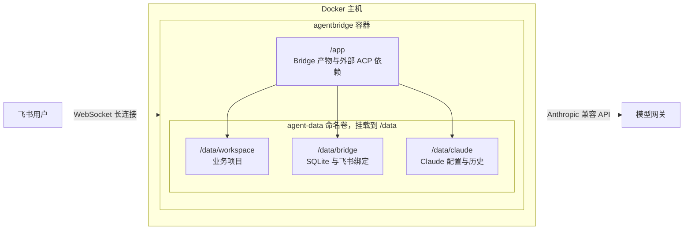

# 部署指南

Bridge 支持从已发布镜像部署和从源码构建。两种方式都固定使用容器内的 `/data/workspace`，通过 `WORKSPACE_PROJECT` 选择项目；`.env` 的 `WORKSPACE_ROOT` 只用于本地 Node。当前仅支持单实例，不要横向扩容共享数据库或项目；容器无需开放入站端口。部署后的使用、命令和排障见[使用与运维指南](usage.md)。

## 部署拓扑



## 按版本拉取镜像

下载仓库中的 `compose.image.yaml` 和 `.env.example`，将后者复制为 `.env`。在 `.env` 中取消 `AGENTBRIDGE_IMAGE` 的注释，选择已经成功发布的版本，例如：

```dotenv
AGENTBRIDGE_IMAGE=ghcr.io/maxtan330/agent-bridge:0.1.0
WORKSPACE_PROJECT=.
```

`0.1.0` 仅为示例，以仓库 Releases 和 Packages 中实际发布成功的版本为准。镜像只发布完整版本号，不维护 `latest`；未设置 `AGENTBRIDGE_IMAGE` 时 Compose 会明确报错。当前构建平台为 `linux/amd64`。发布镜像经过 Cosign 无密钥签名和验签，部署前可按[镜像签名与验证](releases.md#镜像签名与验证)核对身份、版本和 digest；Compose 不自动验签。

```sh
docker compose -f compose.image.yaml pull
docker compose -f compose.image.yaml up -d
docker compose -f compose.image.yaml logs -f
```

升级或回滚时修改 `AGENTBRIDGE_IMAGE` 为目标版本，再执行上述 `pull` 和 `up -d`。从源码部署切换时保持相同目录/Compose 项目名，复用原 agent-data 卷；更换目录时使用 `-p <原项目名>`。首次发布后检查 GHCR 包的访问权限：公开包可匿名拉取，私有包需先登录 GHCR，Portainer 则需配置相应 Registry 凭据，参见 [GHCR 认证说明](https://docs.github.com/en/packages/working-with-a-github-packages-registry/using-the-container-registry)。

## 从源码构建

在完整仓库目录中运行 Compose，使用当前检出的源码和 Dockerfile 构建镜像。通过 shell 环境变量或 Compose 自动读取的 `.env` 配置部署参数；不要求存在 `.env` 文件。业务项目代码由容器内的 Agent 管理。`/data` 使用单个 Docker 命名卷 agent-data，代码位于 `/data/workspace`，不需要在宿主机额外准备业务项目目录或设置 `WORKSPACE_HOST_PATH`。默认 `WORKSPACE_PROJECT=.` 使用 `/data/workspace`，可直接启动后让 Agent 创建项目。

先将 `.env.example` 复制为 `.env`，按需填写网关地址、主模型和认证变量。**Docker 部署无需填写 `WORKSPACE_ROOT`：Compose 固定注入容器路径 `/data/workspace`，不会采用 `.env` 中的同名值，也不会自动挂载宿主机路径。** 使用默认工作区时，在仓库根目录运行：

```sh
docker compose up -d --build
docker compose logs -f
```

如果 Agent 需要操作已有 Git 仓库，可先将该业务仓库克隆到卷中。下例使用 `/data/workspace/my-repo`，部署环境需设置：

```dotenv
WORKSPACE_PROJECT=my-repo
```

`WORKSPACE_PROJECT` 指定的子目录必须在服务启动前存在。首次初始化执行（替换仓库 URL；新项目使用默认 `.` 时跳过 clone）：

```sh
docker compose build
docker compose run --rm --no-deps agentbridge git clone https://your-git-server/team/my-repo.git /data/workspace/my-repo
docker compose run --rm agentbridge node dist/index.cjs --check
docker compose up -d
docker compose logs -f
```

上面的 `docker compose build` 构建 Bridge 服务；随后示例中的 clone 用于初始化 Agent 将要操作的业务项目，两者是不同的代码目录。更新 Bridge 源码后执行 `docker compose up -d --build`，重新构建并启动。业务项目 clone 只在首次初始化时执行。私有仓库需先配置容器可用的认证。日常通过 Agent 或 `docker compose exec -w /data/workspace/my-repo agentbridge bash` 操作代码；使用默认 `.` 时工作目录改为 `/data/workspace`。本地直接运行 Node 时，`WORKSPACE_ROOT` 仍填写本机已存在的绝对路径；Compose 固定使用 `/data/workspace`。

普通重建容器或 `docker compose down` 会保留命名卷；`docker compose down -v` 会删除包括代码在内的持久数据。卷默认跟随 Compose 项目名，部署时保持项目名稳定，避免切换到另一组空卷。备份、迁移和跨主机恢复见[目录、卷与备份](#目录卷与备份)。

## 使用宿主机已有项目目录

如果业务代码已经位于 Docker 主机的 `/srv/projects/my-repo`，在 `compose.yaml` 同目录新建 `compose.override.yaml`，将该项目挂载到容器工作区：

```yaml
services:
  agentbridge:
    volumes:
      - type: bind
        source: /srv/projects/my-repo
        target: /data/workspace
        bind:
          create_host_path: false
```

将 `source` 替换为 Docker 主机上已存在的绝对目录，并确保容器用户 UID 1000 有读写权限；这里填写的是 Docker 主机路径。`.env` 保持 `WORKSPACE_PROJECT=.`，无需设置 `WORKSPACE_ROOT`。如果挂载的是包含多个项目的父目录，再用 `WORKSPACE_PROJECT` 选择其下的项目。

在仓库目录执行以下命令，Compose 会自动合并 `compose.override.yaml`：

```sh
docker compose build
docker compose run --rm --no-deps agentbridge node dist/index.cjs --check
docker compose up -d --force-recreate
docker compose exec agentbridge printenv WORKSPACE_ROOT WORKSPACE_PROJECT
```

最后一条命令在上述配置下应输出 `/data/workspace` 和 `.`。`--check` 验证路径存在及启动配置，不检查写权限。

使用已发布镜像时，将上面的每条 Compose 命令改为 `docker compose -f compose.image.yaml -f compose.override.yaml ...`，并将第一条命令的 `build` 改为 `pull`；显式使用 `-f` 时需要同时列出挂载覆盖文件。

启用该挂载后，项目文件直接读写宿主机目录，SQLite 和 Claude 配置仍保存在原 agent-data 卷。已有卷中的 `/data/workspace` 内容会被挂载遮住，不会自动迁移或删除；如需保留其中的项目，请先复制到宿主机目录。备份时同时保存宿主机项目和 agent-data 卷。下文目录表描述默认命名卷部署。

## Portainer

使用已发布镜像时，可以将 `compose.image.yaml` 粘贴到 Portainer Stack 的 Web editor，在 Stack 环境变量中填写 `AGENTBRIDGE_IMAGE`（完整版本镜像地址）及模型配置，再部署；无需源码构建上下文。复用现有数据时保持原 Stack/Compose 项目名。此配置已做静态检查，Portainer 实际部署仍需在目标环境验证。

`compose.yaml` 则用于源码构建，不能仅粘贴到 Web editor；需要完整仓库上下文和 Compose build 支持。未验证 Portainer 源码构建路径或 Swarm。

首次使用可保留 `WORKSPACE_PROJECT=.`，启动后让 Agent 创建或克隆项目。若改为子目录，需提前在卷中创建该目录。部署后从日志扫码绑定飞书。修改运行环境变量后，在 Portainer 更新 Stack 并重新创建容器；CLI 镜像部署使用 `docker compose -f compose.image.yaml up -d --force-recreate`，并保留原有 override 文件参数。单纯重启不会更新配置。

## 目录、卷与备份

目录职责如下；`.env` 的本地开发路径不会覆盖 Compose 固定的容器路径：

| 路径 | 用途 |
|---|---|
| `/app` | Bridge 程序启动目录 |
| `/data` | 唯一的 agent-data 持久卷挂载点 |
| `/data/workspace` | agent-data 卷内的代码目录，保存 Git 元数据及项目依赖 |
| `/data/workspace/<WORKSPACE_PROJECT>` | Claude ACP 进程 cwd 和 ACP new/load 的 cwd；项目代码、CLAUDE.md 及项目 `.claude` 配置位于这里 |
| `/home/node` | 容器内 HOME，用户为 node（UID 1000） |
| `/data/claude` | CLAUDE_CONFIG_DIR，agent-data 卷内保存 Claude 配置和历史；不当作项目 cwd |
| `/data/bridge` | agent-data 卷内保存 SQLite 和飞书扫码绑定文件 |

项目、SQLite 和 Claude 会话目录共享一个 agent-data 持久卷，分别位于 `/data/workspace`、`/data/bridge` 和 `/data/claude`；HOME 下其他文件（如 `.ssh`、`.gitconfig` 和包管理器缓存）目前不持久化。容器不加载宿主机 Claude 配置。已有卷的权限不会被 Dockerfile 重新修正，修改用户或替换卷后需单独核对目录权限。

备份时保存整个 agent-data 卷；Git 推送不包含未提交文件。迁移部署位置时，先确认旧卷名称；若原卷为 `<旧项目名>_agent-data`，所有 Compose 命令均使用 `docker compose -p <旧项目名> ...`，复用原卷。仓库复制不会迁移 Docker 卷，换宿主机时需另行备份、恢复。

## 镜像内容与构建参数

Dockerfile 分为基础工具、依赖安装、ncc 构建、生产依赖裁剪和最终运行五阶段。最终镜像包含 dist、生产 node_modules、Node/npm、pnpm 12.14.0、Bash、Git、SSH 客户端、curl、ripgrep、CA 和时区数据；不包含 Bridge 源码、TypeScript 或 ncc。pnpm 留在运行镜像供 Agent 安装和测试项目依赖。没有预装 Python/Go/编译器、浏览器或 AWS CLI，项目需要时扩展镜像。Claude 由 ACP 的 SDK 依赖启动，不额外全局安装另一个 Claude CLI。SSH 客户端已安装，但不内置 SSH 密钥或私有仓库凭证。

参考其他项目的镜像源约定，默认 npm/pnpm 使用 npmmirror、apt 使用阿里云、时区为 Asia/Shanghai。Compose 将 `NPM_REGISTRY` 同时传入 Docker 构建参数和容器运行环境，控制构建阶段及 Agent 内的 npm/pnpm；`BASE_IMAGE`、`DEBIAN_MIRROR` 只作为构建参数传入，可在 shell 或 `.env` 中覆盖。修改构建参数后执行 `docker compose up -d --build`。也可使用 `docker build --build-arg NPM_REGISTRY=https://registry.npmjs.org -t agent-bridge:local .` 单独构建。`BASE_IMAGE` 必须是 Node 26 Debian bookworm 基底；现有自研 Node Alpine 镜像不适用于这里的 apt/glibc 配置。

## 环境注入与网关

模型、飞书凭证和其他运行参数在运行时注入；完整变量、默认值与校验规则以[配置契约](design.md#配置契约)为准。Compose 不会自动透传未列出的变量，需要额外参数时应在 `environment` 中添加映射。

`ANTHROPIC_BASE_URL` 选填，使用自定义网关时填写 HTTP(S) 基址，路径应止于 API 根目录。地址缺失或为空白时，Claude 使用自身配置和默认路由，可能请求 Anthropic 官方 API。网关地址、主模型、各档位模型映射及子 Agent 模型在 Compose environment 中显式注入；认证变量同样通过 environment 显式注入，Agent 所需变量再由 runtime 白名单传递。

认证按网关要求选 `ANTHROPIC_API_KEY`（x-api-key）或 `ANTHROPIC_AUTH_TOKEN`（Bearer），未用的变量留空或删除。`ANTHROPIC_MODEL` 配置主模型；需要时设置 `ANTHROPIC_DEFAULT_SONNET_MODEL`、`ANTHROPIC_DEFAULT_OPUS_MODEL`、`ANTHROPIC_DEFAULT_HAIKU_MODEL` 和 `CLAUDE_CODE_SUBAGENT_MODEL` 为网关支持的模型 ID，避免子任务或别名回落到不可用模型。模型别名没有 Bridge 内置映射，不能假定填写主模型会同时覆盖其他模型用途。详见 [Claude 网关配置](https://code.claude.com/docs/en/llm-gateway-connect) 和 [模型配置](https://code.claude.com/docs/en/model-config)。

网关使用自签或私有 CA 证书时，两个 Compose 已映射 `NODE_EXTRA_CA_CERTS`、`SSL_CERT_FILE`、`SSL_CERT_DIR`：先把 CA 文件放入 agent-data 卷（或通过 override 挂载），再设置为容器内路径，空白值等同未设置。

修改运行时变量后，源码部署执行 `docker compose up -d --force-recreate`，镜像部署执行 `docker compose -f compose.image.yaml up -d --force-recreate`；使用 override 时保留相同的 `-f` 参数，Portainer 则更新 Stack。`docker compose restart` 不会重新注入环境变量。

模型配置在运行时注入。Claude 的用户、项目和本地设置也可能覆盖网关地址及模型变量。部署前核对持久卷和项目中的 Claude 设置，并在网关侧确认实际请求路由。当前仅支持 Anthropic 兼容端点；未透传 Bedrock/Vertex/Foundry 开关与云凭证。容器内 `localhost` 指容器自身，宿主机网关需使用容器可达地址。模型网关必须兼容 Anthropic Messages、流式输出和工具调用。

`--check` 只检查 Bridge 配置、已有绑定文件、项目路径与 Adapter 入口，不验证模型凭证、网络、目录写权限或真实模型调用。主模型和认证凭证当前不属于 Bridge 必填校验项，检查通过不能证明它们已正确配置。绑定文件缺少使用者、损坏或手动配置不全时仍会失败，详见[启动状态表](design.md#首次启动与绑定)。

## 上线验收

`AgentBridge started` 在飞书长连接就绪后记录；首次连接超过 30 秒或遇到不可恢复错误会启动失败。运行期间的不可恢复连接错误会记录脱敏日志并以非零退出码停机，由 Compose 重启；可恢复断线由 SDK 重连。连接就绪不代表权限和事件订阅已经生效，部署时仍需实际发消息确认短任务直接回复、长任务通知和最终结果；Typing 表情及卡片原位更新需在 `TASK_REPLY_MODE=stream` 下验证。

配置真实凭证后逐项验证：文本任务修改测试文件、连续对话、免审批读写执行、Typing 清理、CardKit 原生流式与关闭、缺权限时的富文本降级、长文续发和代码块渲染、取消、重复事件、容器重启后恢复。Linux 真实进程组与 Docker 构建运行仍需在目标环境验收；未经此验收不能视为生产上线完成。本地测试使用模拟 ACP 子进程，并包含已安装真实 Adapter 的协议协商检查，不调用模型、不发送飞书消息。
