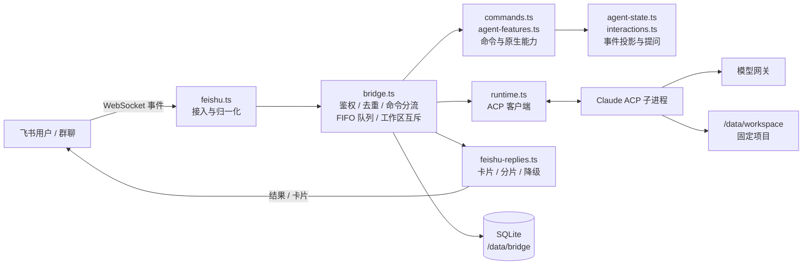
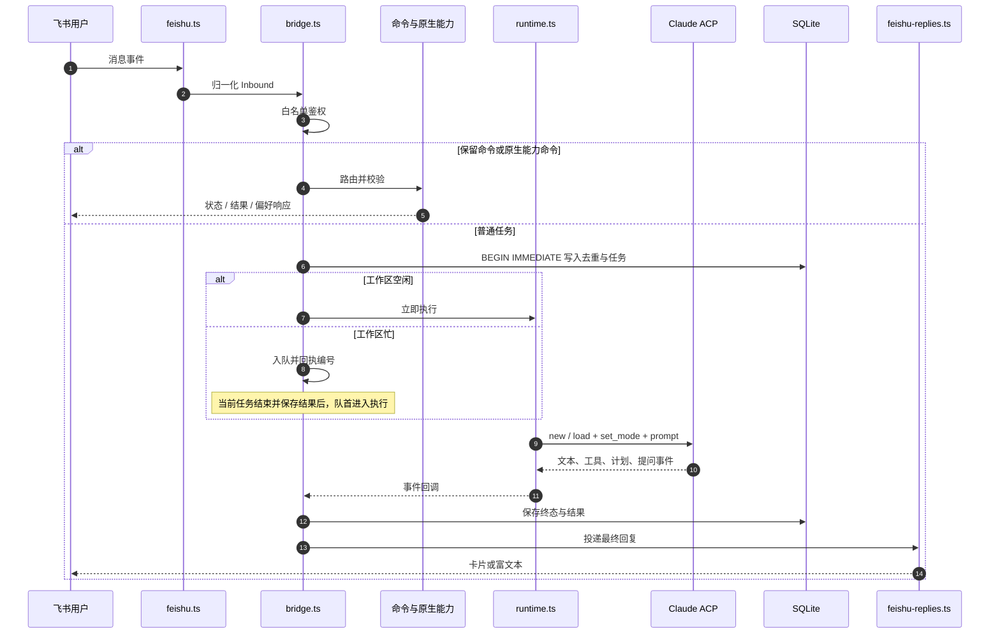
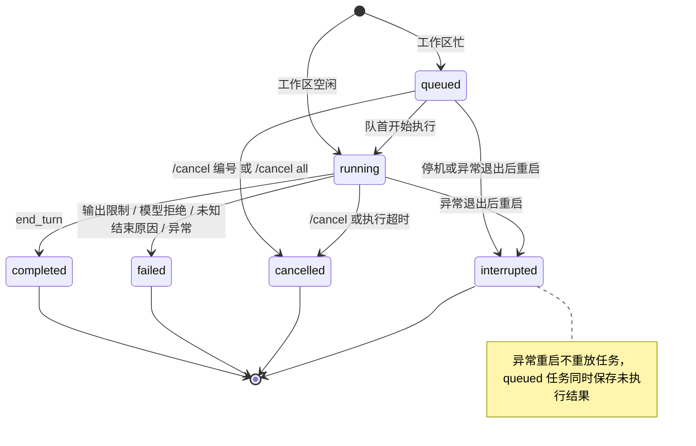
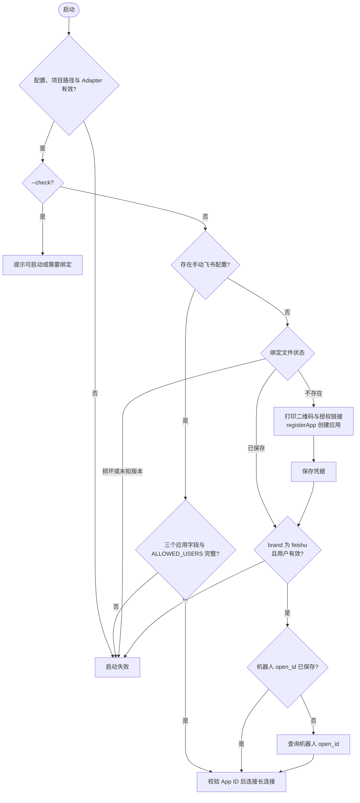

# AgentBridge 实现设计

本文描述仓库当前实现，行为以关联源码和测试为依据。使用、命令与排障见[使用与运维指南](usage.md)，部署操作见[部署指南](deployment.md)，环境变量示例见 [.env.example](../.env.example)。设计与代码变更应在同一提交中更新。

## 设计说明

Bridge 的设计可以概括为三条主线：飞书事件进入后先鉴权、去重和命令分流；普通任务进入串行队列，由 ACP Runtime 驱动 Claude Code 执行；结果先持久化再投递，失败可由 `/result` 取回。跨重启的事实只落在 SQLite，工作区内的任务串行执行，Bridge 本身不承担对话理解或代码规划。

### 架构总览

`bridge.ts` 是唯一能改变任务状态的调度层；`runtime.ts` 只负责 ACP 协议与进程生命周期；`feishu-replies.ts` 只负责投递与降级。飞书接入、命令解析、事件投影和持久化各自独立，均不持有第二套队列。

### 消息处理流程

入队回执与执行并行，最终回复等待本任务回执和在途进度；排队等待不计入执行时限。命令、去重键和会话键的细节见[接入与命令](#接入与命令)。

### 任务状态机

`starting`、`executing`、`cancelling`、`delivering` 是内存中的 TaskPhase，不写入 SQLite 的任务终态；终态与结果文本在同一事务中保存。仅 `end_turn` 记为 `completed`，非正常结束保留部分输出和原因，供 `/result` 取回。正常停机时，执行中任务走取消路径记为 `cancelled`，排队任务记为 `interrupted`。

## 运行范围与技术选型

服务通过飞书 WebSocket 接收消息，由外部 Claude ACP 进程执行任务。默认短任务直接回复，长任务先发送后台通知再返回结果；stream 模式使用 Typing 表情和原位更新的 Markdown 卡片。当前仅支持一个飞书应用、一个固定项目、一个服务实例。工作区内的任务串行执行，忙时按接收顺序排队，默认最多 20 个等待项。飞书投递可以与下一项执行重叠。

运行要求为 Node.js 26，见 [package.json](../package.json)。使用 TypeScript、ACP SDK、飞书 SDK、Pino、Zod 和 Node 内置 SQLite。模块由构造函数注入依赖，不引入 @maxtan/nest-core：当前没有 HTTP 管理接口、Web 鉴权或 Redis 等需要该框架承载的入口。

尚未实现 Git worktree、文件系统隔离、多项目 ACL、多任务并发、其他消息渠道和管理 API。附件支持范围为图片和 UTF-8 文本文件。

## 模块职责

| 模块 | 当前职责 |
|---|---|
| [main.ts](../src/main.ts) | 校验配置和项目路径、组装实例、启动飞书、响应退出信号 |
| [bootstrap.ts](../src/bootstrap.ts)、[feishu-registration.ts](../src/feishu-registration.ts) | 首次扫码注册、凭据持久化、用户白名单绑定、机器人身份查询及终端二维码 |
| [config.ts](../src/config.ts)、[workspace.ts](../src/workspace.ts) | 环境变量校验；通过 realpath 确认固定项目为注册根目录内的现存目录 |
| [feishu.ts](../src/feishu.ts) | 消息归一化、长连接事件与 HTTP 取消 |
| [bridge.ts](../src/bridge.ts) | 用户鉴权、命令、全局任务互斥、会话映射、进度、结果与取消 |
| [agent-features.ts](../src/agent-features.ts)、[commands.ts](../src/commands.ts) | 原生能力应用层与保留命令解析，不拥有队列调度权 |
| [agent-state.ts](../src/agent-state.ts)、[interactions.ts](../src/interactions.ts) | 有界事件投影、独立用户输入请求与校验 |
| [attachments.ts](../src/attachments.ts)、[runtime-config.ts](../src/runtime-config.ts) | 内存附件解码与部署原生配置校验 |
| [runtime.ts](../src/runtime.ts) | ACP stdio 协商、新建/恢复会话、权限模式、prompt 和进程生命周期 |
| [feishu-replies.ts](../src/feishu-replies.ts) | CardKit 流式生命周期、富文本降级、Markdown 分片与续发去重 |
| [task.ts](../src/task.ts) | 任务状态、执行阶段、投递状态、控制命令及执行限制的统一定义 |
| [store.ts](../src/store.ts) | SQLite 去重、任务/结果事务、会话映射和重启恢复 |
| [delivery-error.ts](../src/delivery-error.ts)、[diagnostics.ts](../src/diagnostics.ts)、[timeout.ts](../src/timeout.ts) | 投递错误分类、安全日志字段和有界等待 |

## 接入与命令

### 首次启动与绑定

启动先检查网关/基础配置、项目路径与 Adapter 入口，之后才处理飞书绑定。`--check` 不发起网络操作、不注册、不写入绑定文件；它检查配置是否可进入启动流程，不代表服务已可用。

| 当前绑定状态 | `--check` | 正常启动 |
|---|---|---|
| 无手动配置、无绑定文件 | 成功并提示需要绑定 | 打印二维码，创建新应用 |
| 已保存凭据及白名单用户，仅缺机器人 open_id | 成功并提示需要绑定 | 复用凭据查询机器人，不重新扫码 |
| 完整绑定文件或完整手动配置 | 成功，尚未检查 App ID 格式或远端身份 | 检查 App ID 格式后，使用已有配置启动长连接 |
| 手动字段不全、绑定文件损坏、Lark 记录，或绑定无白名单用户且未显式配置 ALLOWED_USERS | 失败 | 失败，不创建替代应用 |

提示中的“首次正常启动需要绑定”也涵盖仅待查询机器人身份的恢复状态；是否重新扫码由绑定文件是否存在决定。DATABASE_PATH 使用相对路径时，相对于 Bridge 进程 cwd 解析；绑定文件跟随其父目录，与项目 WORKSPACE_ROOT 无关。

任一 FEISHU_APP_ID/FEISHU_APP_SECRET/FEISHU_BOT_OPEN_ID 非空即选择手动模式，必须同时提供这三个字段和非空 ALLOWED_USERS，不能从保存的其他应用补齐白名单用户。否则读取 SQLite 同目录的 feishu-binding.json；不存在时调用官方 SDK registerApp，终端打印二维码和备用验证链接。默认 createOnly=true 限定创建新应用；FEISHU_SELECT_EXISTING_APP=true 时不传 createOnly，确认页额外提供“选择已有应用”入口，扫码者可改为选择自己名下的已有应用并增量开通同一组 addons（preset=false 的机器人最小基座、六个应用权限：发消息、接收私聊、接收群聊 @、读取消息及附件资源、发送/删除表情回复、CardKit 卡片写入，与消息事件订阅），不申请用户身份权限；选择已有应用时的审批与发布规则以确认页为准。

注册返回的应用凭据和扫码用户身份先写入绑定文件，再通过 tenant_access_token 和 bot/v3/info 获取机器人 open_id。写入采用同目录随机临时文件及 rename，POSIX 权限 0600；不打印 App Secret，文件已排除出 Git 和 Docker 构建上下文。文件包含 version、appId、appSecret、brand，以及可选 ownerOpenId/botOpenId。损坏或未知版本停止启动，不创建替代应用。缺少扫码身份时不开放访问，允许显式 ALLOWED_USERS 补足；有扫码身份时该变量也可覆盖白名单用户。

注册前通过临时探测文件检查绑定目录可写；这不能保证授权成功后磁盘仍可写。只有凭据成功保存后才能保证重启复用。绑定文件的位置随 DATABASE_PATH 的父目录变化，备份包含 App Secret，应按凭据管理；操作侧的恢复与迁移步骤见[使用与运维指南](usage.md#接入飞书)。

设备授权最多等待 10 分钟，注册和身份查询的单次 HTTP 请求上限为 15 秒；SIGINT/SIGTERM 中止启动。registerApp 的官方注册请求通过临时、限定 URL 的 Axios 拦截器附加 AbortSignal，并在结束时移除。注册仅使用平台确认页配置，不额外调用应用管理 API 改写订阅方式或强制发布。平台默认 PersonalAgent 长连接流程及 addons 的生效受平台/租户能力影响；缺权限、待审核或回调方式不符时仍需后台确认。绑定完成不等于真实收发、表情反馈和卡片渲染已经验收。

### 消息处理

接入规则（私聊/群聊 @、白名单、附件类型）见[消息规则](usage.md#消息规则)。实现上仅接收 sender_type=user 的事件；群聊必须在 mentions 中包含配置机器人的 open_id，移除对应 mention 占位文本后执行；ADMIN_USERS 不自动获得普通消息执行权限。

原始 content 字符串最多 64,000 个 UTF-16 码元，解析后的 text 最多 16,000 个 UTF-16 码元，长度检查发生在移除 mention 之前。图片和文件事件只先保存资源元数据，鉴权并调度执行后才从飞书下载；流式累计上限为图片 5 MiB、UTF-8 文本 256 KiB，不写入工作区。附件准备最多 30 秒并受任务取消约束。超长、损坏或其他不支持的消息对符合接入规则的白名单用户返回拒绝提示，不截断指令后执行。无效事件、空文本和未获授权消息被忽略。

### 命令路由

命令的完整列表与用户可见行为以[命令](usage.md#命令)为准，本节只说明调度语义。Bridge 保留命令在普通任务接纳前由 `commands.ts` 统一识别并分流：任务、队列、结果和状态类命令不进入模型；管理查询、`/answer`、`/skip` 和引导不占队列容量，队列满时仍可执行；`/new` 立即检查当前会话，存在未完成任务时拒绝；未识别的 slash 指令仍作为普通任务进入 FIFO 队列。原生能力命令由 `agent-features.ts` 在能力协商后校验和转换，不创建第二套队列。

状态查询的可见范围和无任务时的回复见[命令](usage.md#命令)。最近输出仅统计非空的 agent_message_chunk 文本，不代表工具心跳，不据此推断停滞或完成百分比。

消息去重键为 JSON 数组 [feishu, account, messageId]，其中 account 为飞书 App ID。会话键为 [feishu, account, chatId, threadId, userId, workspace绝对路径]；没有 threadId 时使用空字符串。同一聊天不同用户使用各自的 ACP 会话，共享项目文件。群聊中的任务结果和 /result 按原消息回复，同一群聊或话题的成员可见。

## 任务与会话生命周期

回复模式由 TASK_REPLY_MODE 控制，默认 auto；三种模式的用户可见行为见[回复方式](usage.md#回复方式)。实现上，auto 在达到 TASK_BACKGROUND_NOTICE_MS（默认 5 秒，范围 1–60 秒）时通知一次；回执不阻塞模型执行，最终回复等待其有界投递结束；执行结束清除通知计时器，避免迟发“仍在执行”；排队等待不计入该计时。

1. 鉴权后处理控制命令与拒绝输入，独立去重；普通任务进入接纳逻辑。控制命令不会进入队列或模型。
2. 正常任务在 BEGIN IMMEDIATE 事务内同时插入去重记录和 running（空闲）或 queued（繁忙）任务。事务失败整体回滚并提示重新发送。队列满时仅消费消息去重键，明确告知未接纳。队列项的 prompt 仅在内存中保留。
3. 事务成功后设置全局 active，启动执行时限计时；按回复模式启动后台通知或流式进度计时器。只有 stream 模式添加 Typing，反馈失败仍继续执行。
4. 每个任务都重新创建 Adapter 进程；创建前等待上一进程清理。initialize 协议版本必须匹配 SDK 的 PROTOCOL_VERSION。
5. 若有会话映射且 Agent 声明支持 loadSession，则尝试恢复；恢复失败改建新会话。新旧会话 ID 不同时在结果卡片附注说明，不能仅凭数据库映射宣称上下文已恢复。
6. 建立权限模式后保存会话 ID，再发送一次 prompt；发送结果失败不会重放 prompt。
7. 仅 stopReason 为 end_turn 时标记 completed；取消响应标记 cancelled，达到执行或输出限制、模型拒绝、未知结束原因及执行异常标记 failed。非正常结束响应保留部分输出并附原因，随结果持久化，供 /result 取回。取消和失败路径等待运行进程清理。清理失败时停止接受新消息，并保留运行进程句柄以便再次清理。
8. 执行结束后，取消或失败路径先清理 Adapter；随后在同一事务中保存终态与最终文本，刷新会话时间并释放工作区。同步将队首 queued 改为 running 并设置 active，保持 FIFO。入队回执与执行并行，最终回复等待本任务的回执及在途进度消息。不同任务的飞书回复可并行投递。队列启动落库或进程清理失败时停止调度并中断剩余队列。

成功任务的 Adapter 暂时保持驻留，下一任务 open 时重建进程，或在停机及全局闲置满 SESSION_IDLE_TIMEOUT_MS（默认 4 小时）时清理。执行中和队列非空时不执行空闲进程回收；新任务等待已开始的空闲清理完成再 open，防止新进程被旧清理终止。子进程 stdout 用于 ACP，stderr 被消费但不写入业务日志。初始化、新建、恢复、设置模式的单次请求上限各为 30 秒；prompt 由整体任务超时控制。

会话映射保存 last_used_at，在建立会话及释放工作区前更新。执行入口仅恢复尚未闲置满 SESSION_IDLE_TIMEOUT_MS 的映射，过期则创建新会话；运行中的长任务不因该期限被打断。查询、回执及排队接纳不刷新时间，排队任务在实际执行时判断过期。全局闲置回收也清除过期映射，但不删除任务结果或 Claude 历史。管理命令在普通任务接纳前分流，队列满时仍可执行；/new 在当前会话有执行中或排队任务时拒绝重置。

TASK_TIMEOUT_MS 默认 7,200,000 毫秒（2 小时），最大 86,400,000 毫秒（24 小时），覆盖会话初始化及 prompt 执行；文字输出不会重置该截止时间，无文字输出也没有单独的空闲取消计时器。执行结束后清除执行计时器，结果投递及清理使用各自的有界等待。关闭飞书客户端不改变任务执行；服务重启、Adapter 退出和模型网关错误仍会中断任务。本实现支持长时间执行的单轮任务，提供进程内有界 FIFO 队列，排队时间不计入执行时限；不提供跨重启恢复调度或脱离 prompt 生命周期的命令完成通知。

内存阶段使用 TaskPhase：starting（准备）、executing（执行）、cancelling（取消）、delivering（结果发送与清理）；它们独立于 SQLite 中的任务终态。TaskState、DeliveryState、ChatCommand、StopReason 和 TaskLimits 在 task.ts 中集中定义为 as const 对象及派生联合类型；runtime 的免审批模式 ID、飞书回复消息类型、卡片正文元素 id 和投递错误类别同样以模块级常量收敛。不使用 enum 关键字，兼容 Node 直接运行 TypeScript 和 tsconfig 的 erasableSyntaxOnly。数据库中保存的即为这些字符串值。源码注释解释事务、去重、超时和进程清理约束；协议方法名、Zod 字面量和一次性局部字符串保持原样，不追求全部枚举化。

## 持久化与恢复

SQLite 开启 WAL，busy_timeout 为 5 秒。使用 CREATE TABLE IF NOT EXISTS 初始化，并检查 sessions 字段，为旧数据库添加 last_used_at；旧行保持 NULL，下次使用时淘汰映射。当前没有独立迁移框架。

| 表 | 保存内容与语义 |
|---|---|
| messages | 去重键和接收时间；不保存消息正文 |
| sessions | 会话键到 ACP session ID 的映射及 last_used_at 闲置时间 |
| session_history | Bridge 创建或恢复过的会话 ID、所属会话键和最近使用时间；只在所属用户/聊天/话题内列出 |
| session_preferences | 会话键对应的 model、effort、mode 偏好，运行时验证支持后生效 |
| tasks | 任务 ID、会话键、消息去重键、状态和时间；新建进入 running 或 queued |
| results | 任务 ID、最终发送文本、pending/sent/failed 投递状态、投递轮次数 attempts |

tasks 使用 queued/running/completed/failed/cancelled/interrupted。启动在同一事务内为遗留 queued 任务保存“重启中断且未执行”的结果，并将 queued/running 改为 interrupted（同时刷新 at，保留期从最后一次状态变更计算）；不自动重放任务或补发结果。对历史 running 任务仍不虚构执行结果。正常停止时先从内存移走全部等待项并同步记录 interrupted 结果，再尽力发送通知。取消排队任务保存 cancelled 结果。

/result 按会话键和结果写入顺序查询最近已保存结果，可能是当前运行任务之前的结果；取消较晚提交的排队任务不会遮住随后完成的当前任务答案。带任务编号时按同一会话键精确查找；failed 按写入顺序查找投递失败的结果。每次完整结果投递结束后 attempts 加一，含用户重取。任一次投递成功即保留 sent 状态。回复正文与任务终态同事务保存（会话恢复附注仅用于本次任务投递）；若数据库不可写，则记录错误并尽力发送，不能保证结果持久化。

SQLite 不保存完整模型历史；Adapter 会话目录需另外持久化。每次启动在标记中断之后按 DATA_RETENTION_MS（默认 30 天，范围 1 天至 365 天）在同一事务内删除超过保留期的 messages、tasks、results（含任务行已不存在的孤儿结果）和 session_history 行。tasks/results 以任务最后一次状态变更时间为准，保留任务关联的消息去重键也继续保留。清理不会删除 session_preferences 和会话映射，后者按闲置期限回收。去重键清理后，同一事件如再次送达可被重新接纳。`/result` 可取回仍保存在数据库中的结果。

## 权限约束

new/load 均传入 _meta.claudeCode.options.allowDangerouslySkipPermissions=true。默认返回会话必须声明支持 bypassPermissions，并成功响应 session/set_mode(bypassPermissions)，之后才允许 prompt。用户显式 /mode plan 时要求支持并确认 plan 模式，不退回执行模式。缺少模式、设置失败或运行时切换到非请求模式时终止任务，不退回逐条手动审批。模型及 effort 按原生配置选项验证。settings 同时设置 includeCoAuthoredBy=false、attribution.commit/pr 为空及 sessionUrl=false，不修改 Git 作者。

此部署采用 Claude Code 免审批执行：白名单用户启动的任务可直接在容器用户权限下读写文件和执行命令。Bridge 不逐条代点允许；意外收到 session/request_permission 时直接 cancelled，不发送卡片或等待审批。Bridge 不提供客户端文件/终端 ACP 能力，读写和命令由 Agent 自身工具执行。cwd 不是沙箱，所有用户必须获授权访问容器可读写的资源。

普通信息问题通过独立 elicitation/create 处理，不能作为工具授权。每个问题绑定任务会话和请求编号，/answer、/skip 不进入任务队列；任务结束和取消会释放等待。完整模块边界、命令及能力限制见 [Claude 原生能力](claude-capabilities.md)。

## 取消与进程清理

/cancel 和任务超时设置取消标记、中止正在进行的 open；已获得 session ID 时发送 ACP cancel。即使 Agent 正常返回 cancelled，也会执行 stop。超过 CANCEL_GRACE_MS 后仍未完成执行则强制 stop。

stop/open 等待同一轮清理 Promise；空 stop 不缓存结果，清理结束或失败后重置 Promise。只有清理成功才清空进程句柄，防止失败后无法再次终止旧进程。

POSIX 启动独立进程组：先 SIGTERM，最多等待 1.5 秒；仍存活则 SIGKILL，再最多等待 1.5 秒确认整个组不存在。组长退出不代表进程组消失。信号操作仅忽略 ESRCH，其他错误传播；存活超时抛错。Windows 使用相同的有界等待确认 Adapter 主进程退出，但不保证其工具子进程被终止。

收到 SIGINT/SIGTERM 后先关闭飞书长连接，再取消任务、停止 Adapter、等待任务收尾并关闭数据库。执行完成与消息投递完成分别等待，避免取消流程等待自己的最终发送。系统没有独立的全局停机截止定时器；compose 的 stop_grace_period 为 45 秒。

## 输出、投递与诊断

只转发 agent_message_chunk 的文本，不转发内部思考内容。输出缓存保留末尾 24,000 个 Unicode 码点，超限时在正文前加截断提示；最终保存相同文本。stream 模式下每 250 毫秒至多提交一次累计快照，新输出在上次更新进行中合并，不并发修改卡片；最终结果等待在途进度结束后投递，避免旧进度覆盖最终内容。不附带任务 ID 或原始 stopReason；取消或非正常结束响应保留部分输出时，会附明确的原因提示。

首次有实际输出或结束时调用 cardkit.v1.card.create 创建 card_json，schema=2.0、config.streaming_mode=true，body 仅包含 element_id=content 的 Markdown 元素，不设置任务标题或折叠容器。通过 im.message.reply 发送 msg_type=interactive 的卡片引用，随后调用 cardkit.v1.cardElement.content 写入累计正文；递增 sequence、独立操作 UUID 控制更新顺序。最终正文写入后调用 card.settings 关闭 streaming_mode 并设置最多 100 个码点的摘要。关闭失败只记录日志，任务清理再以 3 秒窗口尝试关闭，不重复发送已接受的正文。卡片状态仅保留于当前任务内存，不跨重启恢复。

每片最多取 3,000 个原文码点，优先在后半段的换行处切分；常见反引号/波浪线代码围栏跨段时补齐闭合与重新打开标记，不删除原文。第一片在同一卡片中更新，后续分片在最终阶段按序发送 post，内容为 zh_cn.content 中的 md 元素。控制回复和 /result 也使用该富文本路径。分片限制及围栏上限使序列化内容低于 28,000 字节；这不是完整 Markdown 语法树切分，极长表格或行内标记跨段可能影响格式。模型输出中的 at 标签前缀会转义，避免解析为飞书群成员通知。

CardKit 创建或正文更新失败，或卡片引用发送被 API 明确永久拒绝时，本任务停止尝试流式更新，最终通过 post 投递完整已保存回复；若已有预览则先尝试关闭旧卡片。卡片引用发送结果不明确或被限流时保留 card_id，重试使用相同 UUID 与引用内容，不立即另发富文本，以免出现重复回复。后续富文本分片使用稳定 UUID，并在任务内记录已确认的分片，重试从未确认分片继续。Bridge 不在渠道失败后另发整份结果；未送达内容可用 /result 主动取回。

仅 stream 模式在原消息上添加一次 Typing，与模型启动并行，结束/失败/取消后移除，不循环重加；添加和移除分别最多等待 3 秒，失败只记录脱敏日志。需要 im:message.reactions:write_only，CardKit 另需 cardkit:card:write；已有应用由管理员补充并发布，新扫码申请这两项。进程异常退出或远端清理失败可能遗留表情或流式状态。

最终投递遇到可恢复网络错误/限流最多尝试 3 次，卡片与富文本共用 15 秒窗口；进度投递不做应用层重试，下一快照可继续未完成的卡片引用发送。CardKit 创建/正文更新异常优先降级，关闭异常不将已接受的结果标为未送达。每个 HTTP 请求上限 10 秒，由独立 HTTP 实例通过 AsyncLocalStorage 接收当前 AbortSignal；过期窗口不继续发送余下分片。重试不重放 Agent prompt。交互路径参考 OpenClaw 的 [streaming-card.ts](https://github.com/openclaw/openclaw/blob/main/extensions/feishu/src/streaming-card.ts) 和 [reply-dispatcher.ts](https://github.com/openclaw/openclaw/blob/main/extensions/feishu/src/reply-dispatcher.ts)，不表示已实现其所有渠道能力。

扫码时优先输出授权链接。日志二维码使用 L 纠错级别降低密度，每个模块占两个字符宽、一行高，不使用半格字符。每行独立设置 ANSI 黑色前景/亮白背景，深色模块同时设置黑背景并输出实心块，浅色模块输出两个空格；颜色变化处切换背景，行尾重置。四模块留白明确为白色，不依赖深色主题。剥离 ANSI 后仍保留字符图案，但不能保证主题对比度；查看器行距、字体和自动换行也可能破坏扫描，因此不声称日志图案适用于所有 Portainer 版本。

同时生成 SQLite 同目录的 feishu-qr.svg（M 纠错级别、固定黑白及四模块留白），不受日志渲染影响，注册结束后尝试删除。图片写入失败时仍可使用链接和字符二维码。日志提示展开区域并关闭时间戳、自动换行；不为缩短二维码而删掉授权 URL 的权限、名称或 createOnly 参数。

日志记录任务 ID、阶段、安全错误类别/代码和投递分类，不输出原始异常、请求头、prompt 或环境变量。首次注册还会向标准输出打印有时效的授权二维码和链接，能够访问日志的人可使用该链接，应限制首次启动日志的访问。

飞书 Client/WSClient 使用静默 logger，EventDispatcher 仍使用 SDK 默认日志。Feishu.start 校验 App ID 格式后等待 onReady，首次连接最多等待 30 秒；SDK 启动拒绝、onError 或超时均关闭连接并拒绝启动。main 仅在就绪且未收到退出信号后记录 AgentBridge started。运行期间的终止性 onError 记录固定脱敏错误，关闭连接，触发 main 停机并将退出码设为 1；Compose 可据此重启。可恢复断线由 SDK 重连，并记录重连中/已恢复日志。stop 会拒绝尚未完成的启动等待，关闭后的迟到就绪回调被忽略。就绪仅证明 WS 已连接，不证明应用消息权限及事件订阅正确，仍需实际收发验收。

## 配置契约

配置来源为进程环境；开发/启动脚本支持加载本地 .env，Docker Compose 通过 environment 显式映射注入，插值来源可为 shell、可选的 .env 或 Portainer Stack 环境变量，不依赖 env_file。ANTHROPIC_BASE_URL 选填，非空时校验 HTTP(S) URL。Runtime 将空白网关地址从子进程环境中移除。其余模型变量经白名单透传，凭证和模型是否可用由实际请求验证。

| 变量 | 默认值/要求 |
|---|---|
| FEISHU_APP_ID / FEISHU_APP_SECRET / FEISHU_BOT_OPEN_ID | 默认不填写，首次扫码后保存；手动模式三项必须同时提供；Compose 显式映射，空白保持扫码模式 |
| FEISHU_APP_NAME | 首次扫码创建的预设名称，默认 AgentBridge；去除首尾空白，空值使用默认值；Compose 显式映射，不修改已有应用 |
| FEISHU_SELECT_EXISTING_APP | 仅接受 true/false，默认 false；true 时首次扫码确认页可选择已有应用并增量授权；Compose 显式映射 |
| ALLOWED_USERS | 逗号分隔 open_id；自动模式默认扫码者，手动模式必须至少一个；Compose 显式映射 |
| ADMIN_USERS | 默认空列表 |
| WORKSPACE_ROOT | 本地 Node 必填，取消 .env.example 中的注释并设置已存在的绝对目录；相对路径由 Bridge 进程 cwd 解析。Compose 固定注入 /data/workspace，不读取 .env 的同名值，也不据此挂载宿主机目录 |
| WORKSPACE_PROJECT | 默认 .，解析后的目录必须存在且位于 WORKSPACE_ROOT 内；Compose 从部署环境读取，用于选择 /data/workspace 内的项目 |
| DATABASE_PATH | 默认 data/agentbridge.db |
| DATA_RETENTION_MS | 默认 2592000000（30 天）；范围 86400000–31536000000；启动时清理更早的去重、任务、结果与会话历史行；Compose 显式映射 |
| TASK_TIMEOUT_MS | 默认 7,200,000（2 小时）；范围 1,000–86,400,000；Compose 显式映射，可通过部署环境覆盖 |
| TASK_REPLY_MODE | 默认 auto：短任务直接返回，长任务通知一次；background 始终先回执；stream 显示 Typing 与流式卡片 |
| TASK_BACKGROUND_NOTICE_MS | auto 模式通知延迟，默认 5000；可设 10000，范围 1000–60000；从实际执行开始计时，Compose 显式映射 |
| SESSION_IDLE_TIMEOUT_MS | 默认 14400000（4 小时）；范围 60000–604800000；会话及全局空闲 Adapter 回收期限，Compose 显式映射 |
| CLAUDE_RUNTIME_CONFIG | 可选 JSON 文件路径，支持 mcpServers/maxTurns/maxBudgetUsd；相对工作区解析，Compose 显式映射；不回显凭据 |
| CANCEL_GRACE_MS | 默认 5,000；范围 100–30,000 |
| ANTHROPIC_BASE_URL | 选填 HTTP(S) 网关基址。缺失或为空白时交由 Claude 解析路由，非空但格式错误时拒绝启动 |
| ANTHROPIC_AUTH_TOKEN / ANTHROPIC_API_KEY | Bridge 不校验是否设置；按网关选择 Bearer 或 x-api-key 凭证 |
| ANTHROPIC_MODEL | Bridge 不校验是否设置；部署时填写网关可用的主模型 ID |
| ANTHROPIC_DEFAULT_SONNET_MODEL / ANTHROPIC_DEFAULT_OPUS_MODEL / ANTHROPIC_DEFAULT_HAIKU_MODEL | 可选模型别名映射；仅主模型变量不能保证所有子任务使用同一模型 |
| ANTHROPIC_DEFAULT_FABLE_MODEL | 使用 fable 别名时可配置的模型映射；需网关提供相应模型 |
| 其他 ANTHROPIC_* | 按前缀透传，具体支持情况由 Adapter/Claude SDK 决定，Bridge 不逐项校验 |
| NODE_EXTRA_CA_CERTS / SSL_CERT_FILE / SSL_CERT_DIR | 可选的自签网关 CA 证书路径，白名单透传给 Agent 子进程；空白等同未设置；Compose 显式映射，路径须为容器内路径 |
| APPDATA / LOCALAPPDATA / SYSTEMDRIVE | Windows 本地开发工具链所需，存在时白名单透传；Linux 容器内通常不存在 |
| CLAUDE_CONFIG_DIR | 本地可选；Compose 固定为 /data/claude |
| CLAUDE_CODE_SUBAGENT_MODEL | 可选，透传子 Agent 默认模型 |
| NPM_REGISTRY | Compose 同时用于构建参数和运行环境的 npm/pnpm 源，默认 npmmirror |
| BASE_IMAGE / DEBIAN_MIRROR | 仅构建参数；Compose 从部署环境读取并传给 Dockerfile，也可通过 docker build --build-arg 传入 |

Agent 子进程仅获得运行所需的系统路径、临时目录、HOME/USERPROFILE、大小写代理变量、LANG/LANGUAGE/LC_*/TZ、ANTHROPIC_*、CLAUDE_CONFIG_DIR、CLAUDE_CODE_SUBAGENT_MODEL 和 npm_config_registry（变量名大小写均可）；不透传飞书密钥、NPM_TOKEN 或其他云凭证。当前使用 Anthropic 兼容端点，不支持通过进程环境启用 Bedrock/Vertex/Foundry。此处只约束环境变量，不是操作系统隔离：项目 cwd、白名单和同容器非 root 均不能阻止 Agent 访问其他可读文件。所有白名单用户必须被授权访问固定项目。

自定义网关通过 ANTHROPIC_BASE_URL 配置。省略时由 Claude 设置及默认行为决定路由，可能使用 Anthropic 官方 API。ANTHROPIC_API_KEY 对应 x-api-key、ANTHROPIC_AUTH_TOKEN 对应 Bearer，选用网关要求的认证方式。ANTHROPIC_MODEL 为主模型，ANTHROPIC_DEFAULT_SONNET_MODEL/OPUS_MODEL/HAIKU_MODEL 可映射别名，CLAUDE_CODE_SUBAGENT_MODEL 指定子 Agent 默认模型。Adapter 读取 user/project/local 设置，settings 的 env 可能覆盖进程中的网关地址、模型及认证变量。Bridge 当前只校验和传递进程环境。部署需核对 Claude 设置，并在网关侧确认实际路由。--check 仅在配置网关地址时校验其格式。模型鉴权、网络连通性和目录写入需要单独验证。

## 构建和部署结构

版本发布由 Release Please 管理：发布 PR 同步 `package.json`、`CHANGELOG.md` 和 manifest，合并后创建 GitHub Release，并直接调用镜像 workflow。发布前校验 tag、package、manifest 和 changelog 一致；镜像仅使用 package 的完整稳定版本号，发布后由独立 job 使用 Cosign/OIDC 对 digest 签名并验证；普通 main/PR 构建不发布、不签名。ACP 握手、启动日志和 --version 同样读取 package 版本。详见[版本发布](releases.md)。

提供两个 Compose 文件：`compose.yaml` 使用当前仓库作为 build context 构建，`compose.image.yaml` 不构建、要求显式设置 `AGENTBRIDGE_IMAGE` 为已发布版本；两者的运行时环境、命名卷和固定路径保持一致。也可将宿主机代码目录 bind mount 到 `/data/workspace`，此时项目代码由宿主机持久化，SQLite 和 Claude 配置仍在 agent-data 卷。部署步骤、卷迁移与备份见[部署指南](deployment.md)。

直接依赖与开发依赖使用 ^ 范围，pnpm-lock.yaml 固定实际安装版本；升级时更新锁文件并重新验证。必须保留可选平台二进制，TypeScript 7 与 Claude SDK 均依赖它们。工具版本以 package.json 为准。

构建链路为 TypeScript 输出 .build → scripts/entry.cjs → ncc → dist/index.cjs。CommonJS 边界兼容飞书 SDK 的 __dirname。交付整个 dist 目录，包含 ncc 生成的 worker 资源。Claude ACP 作为外部子进程依赖保留在生产 node_modules，不能仅交付单个 JS 文件。

[Dockerfile](../Dockerfile) 默认使用 node:26.13.0-bookworm-slim，BASE_IMAGE 可替换为兼容的 Node 26 Debian bookworm 内部镜像。分 base、dependencies、build、production-dependencies、runtime 五阶段；runtime 包含 dist 及外部 Adapter 生产依赖，以 node 用户运行，不包含 Bridge 源码、TypeScript、ncc。镜像保留 Debian/glibc，不直接使用 Alpine Node 镜像；Claude 使用 SDK 的平台二进制，不另装全局 CLI。镜像内预装工具、镜像源和构建参数的清单见[部署指南](deployment.md#镜像内容与构建参数)。

[compose.yaml](../compose.yaml) 启用 init、unless-stopped、no-new-privileges 并删除 capabilities，不开放入站端口。单个 agent-data 命名卷挂载到 /data，下分 workspace（代码）、bridge（SQLite 和飞书绑定）、claude（Claude 配置与历史）三个目录；不绑定宿主机代码目录时，项目在容器内 clone 或创建。Compose 固定 WORKSPACE_ROOT=/data/workspace、DATABASE_PATH=/data/bridge/agentbridge.db、HOME=/home/node、CLAUDE_CONFIG_DIR=/data/claude，以覆盖 .env 中用于本地开发的路径；WORKSPACE_PROJECT 从部署环境读取，默认 .，最终 Agent cwd 与 ACP new/load cwd 均为 /data/workspace 下选中的绝对真实路径，Bridge 自身 cwd 保持 /app。Compose 显式映射模型、认证和超时变量，未列出的变量需额外添加 environment 映射；Agent 所需变量再经 runtime 白名单传递，不烘焙入镜像。运行时变量变更需要重建容器，详见[部署指南](deployment.md#环境注入与网关)。只部署一个实例，不支持多个实例共享工作区或数据库。

## 验证依据与验收边界

| 行为 | 可重复执行的依据 |
|---|---|
| 配置校验 | [config.test.ts](../test/config.test.ts) |
| 扫码绑定、重启复用、失败恢复与身份拒绝 | [bootstrap.test.ts](../test/bootstrap.test.ts) |
| 注册参数、二维码、HTTP 取消与脱敏 | [feishu-registration.test.ts](../test/feishu-registration.test.ts) |
| 无网关、无绑定时 --check，网关格式错误时不注册，运行期终止错误触发非零退出 | [startup.test.ts](../test/startup.test.ts)，替换网络入口验证主流程，不连接真实 WS |
| WS 就绪等待、终止失败、超时、停机及无效 App ID | [feishu-lifecycle.test.ts](../test/feishu-lifecycle.test.ts)，SDK HTTP 和生命周期回调使用替身，不连接真实飞书 |
| 路径、事务、持久化 | [core.test.ts](../test/core.test.ts) |
| 鉴权、互斥、取消、结果重试与取回 | [bridge.test.ts](../test/bridge.test.ts) |
| FIFO 队列、自动回复时机、4 小时闲置回收 | [queue.test.ts](../test/queue.test.ts)、[background-reply.test.ts](../test/background-reply.test.ts)、[session-idle.test.ts](../test/session-idle.test.ts) |
| 原生命令、事件投影、交互问题和配置 | [native-commands.test.ts](../test/native-commands.test.ts)、[agent-state.test.ts](../test/agent-state.test.ts)、[interactions.test.ts](../test/interactions.test.ts)、[runtime-config.test.ts](../test/runtime-config.test.ts) |
| 原生能力协商、模式、署名设置及附件输入 | [runtime-capabilities.test.ts](../test/runtime-capabilities.test.ts)、[attachments.test.ts](../test/attachments.test.ts) |
| 结束原因、部分输出和失败清理后继续队列 | [stop-reason.test.ts](../test/stop-reason.test.ts) |
| package、标签、manifest 和 changelog 一致性 | [release.test.ts](../test/release.test.ts) |
| 一小时无输出、两小时取消、状态查询权限与执行阶段 | [long-task.test.ts](../test/long-task.test.ts)，使用虚拟时间和 Runtime 替身，非真实一小时模型调用 |
| stdio、模式建立、环境隔离与清理 | [runtime.test.ts](../test/runtime.test.ts) 及本地 Agent 夹具 |
| 飞书输入、单卡更新、Typing、分片、HTTP 信号与错误分类 | [feishu.test.ts](../test/feishu.test.ts) |
| CardKit 生命周期、降级、长文续发去重与 Markdown 代码围栏 | [feishu-replies.test.ts](../test/feishu-replies.test.ts)，含模拟一小时后远端拒绝流式更新的最终回传 |
| 日志脱敏和有界等待 | [diagnostics.test.ts](../test/diagnostics.test.ts)、[timeout.test.ts](../test/timeout.test.ts) |
| 安装的真实 Adapter 协商 | [adapter.test.ts](../test/adapter.test.ts)，不调用模型 |
| 实际产物启动、模块加载、配置和 Adapter 路径 | [smoke.mjs](../scripts/smoke.mjs)，不连接外部服务 |

本地验证命令为 pnpm typecheck、pnpm test、pnpm build、pnpm test:bundle。当前在 Windows / Node 26.12.0 验证了上述命令，测试覆盖上述行为；workflow 通过 actionlint 静态检查。Linux 清理分支由受控进程组替身验证，实时验证结果以当前提交的 CI 为准。

真实飞书扫码注册、收发及卡片点击、模型工具执行与权限设置组合、真实历史会话恢复、代理连通性、Linux 真实进程树清理、Docker 镜像构建运行均未完成验收。扫码注册测试使用模拟授权响应和传输，不创建真实应用。上述限制保留为部署条件，自动测试通过不代表生产验收完成。
